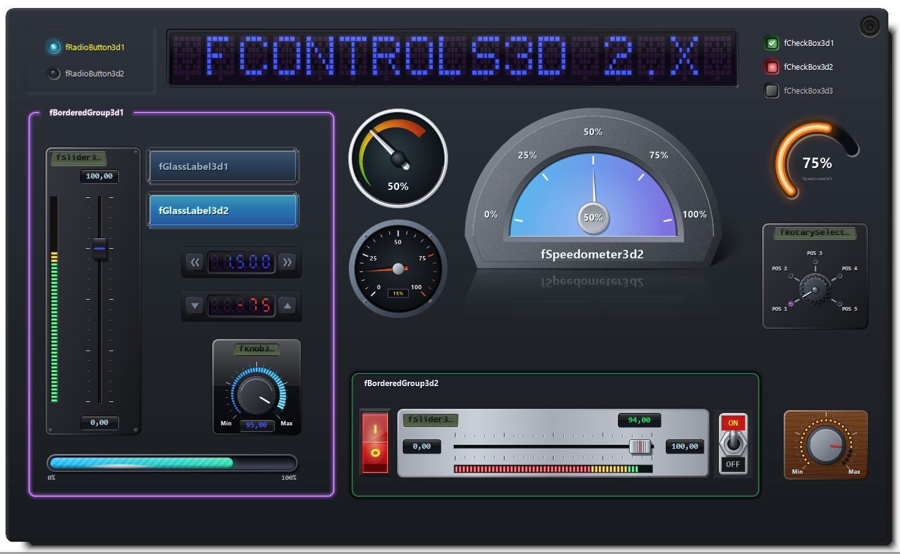

> **Get the Pro License:** Unlock unlimited 3D Forms and controls across all projects — [FControls3d Pro License (v2.x Perpetual)](https://gordiano5.gumroad.com/l/FControls3d-Pro)

# FControls3d

[](https://www.nuget.org/packages/FControls3d)
[](https://www.nuget.org/packages/FControls3d)
[](LICENSE.txt)
[](https://dotnet.microsoft.com)

**FControls3d** is a comprehensive suite of high-precision, industrial-grade **3D Hardware-Style Custom Controls & 3D Physical Form Chassis Engine** for **Windows Forms (WinForms)**.

Engineered completely in pure **GDI+ (`System.Drawing`)** with hardware-accelerated double buffering, custom lighting physics, directional 3D specular bevels, and zero external dependencies, **FControls3d** lets you transform standard Windows desktop applications into realistic **audio consoles, studio racks, industrial HMI dashboards, telemetry panels, and embedded instrumentation**.

---

## Table of Contents

- [Flagship Feature: 3D Physical Form Chassis (`this.FMake3d()`)](#flagship-feature-3d-physical-form-chassis-thisfmake3d)
- [Included 3D Suite Components](#included-3d-suite-components)
- [Installation](#installation)
- [Quick Start](#quick-start)
- [Licensing & Free Tier vs. Pro Edition](#licensing--free-tier-vs-pro-edition)
- [Controls & Chassis API Reference](#controls--chassis-api-reference)
   - [1. `F3dForm` / `this.FMake3d()` — 3D Physical Form Chassis](#1-f3dform--thisfmake3d--3d-physical-form-chassis)
  - [2. `FSlider3d` — 3D Studio Fader & Linear Slider](#2-fslider3d--3d-studio-fader--linear-slider)
  - [3. `FKnob3d` — 3D Precision Rotary Potentiometer](#3-fknob3d--3d-precision-rotary-potentiometer)
  - [4. `FRotarySelector3d` — 3D Multi-Position Rotary Switch](#4-frotaryselector3d--3d-multi-position-rotary-switch)
  - [5. `FSwitch3d` — 3D Tactile Toggle & Rocker Switch](#5-fswitch3d--3d-tactile-toggle--rocker-switch)
  - [6. `FCheckBox3d` — 3D Hardware Push-Button & Illuminated CheckBox](#6-fcheckbox3d--3d-hardware-push-button--illuminated-checkbox)
  - [7. `FRadioButton3d` — 3D Mutually Exclusive Tactile Radio Selector](#7-fradiobutton3d--3d-mutually-exclusive-tactile-radio-selector)
  - [8. `FSpeedometer3d` — 3D Analog Telemetry Gauge](#8-fspeedometer3d--3d-analog-telemetry-gauge)
  - [9. `F36SegmentsDisplay3d` — 3D 36-Segment Alphanumeric Matrix VFD/LED Display](#9-f36segmentsdisplay3d--3d-36-segment-alphanumeric-matrix-vfdled-display)
  - [10. `F7SegmentsDisplay3d` — 3D 7-Segment Numeric VFD/LED Display with Dot & Comma](#10-f7segmentsdisplay3d--3d-7-segment-numeric-vfdled-display-with-dot--comma)
  - [11. `FNumericUpDown3d` — 3D Tactile Numeric Input with Embedded 7-Segment LED Display](#11-fnumericupdown3d--3d-tactile-numeric-input-with-embedded-7-segment-led-display)
  - [12. `FBorderedGroup3d` — 3D Milled Hardware Enclosure](#12-fborderedgroup3d--3d-milled-hardware-enclosure)
  - [13. `FEmbossFrame3d` — 3D Engraved Panel Bevel & Divider](#13-fembossframe3d--3d-engraved-panel-bevel--divider)
  - [14. `FGlassLabel3d` — 3D Backlit Glass LCD / Acrylic Readout](#14-fglasslabel3d--3d-backlit-glass-lcd--acrylic-readout)

---

## Flagship Feature: 3D Physical Form Chassis (`this.FMake3d()`)

**Turn any classic, flat Visual Studio `Form` into a solid, physical 3D Hardware Console with a single line of code.**

You don't need to inherit from custom base forms, wrestle with Visual Studio Designer errors, or manually draw borderless window chrome. Simply call **`this.FMake3d()`** right after `InitializeComponent();` in your existing `Form` constructor, and **FControls3d** immediately transforms your entire window into a tactile, precision-milled 3D chassis:

```csharp
public MainForm()
{
    InitializeComponent();

    // Instant 3D Physical Hardware Console transformation!
    this.FMake3d();
}
```

### What `this.FMake3d()` Does Automatically

- **Instant Borderless Physical Chassis:** Strips away standard Windows title bars and borders, locks physical dimensions against accidental stretching, and injects high-DPI anti-aliased double-buffered rendering (`HighQualityBicubic` & `HighQuality` smoothing).
- **Geometric Chassis Shapes (`Rectangle` & `Ellipse`):** Sculpt your window as a classic rounded-corner rack/desktop enclosure (`Form3dShape.Rectangle` with custom `CornerRadius`) or a true circular/elliptical instrument body (`Form3dShape.Ellipse`) with smooth anti-aliased perimeter shading.
- **3D Raised Perimeter Emboss (`Up` Bevel):** Renders a realistic multi-sample directional 3D raised bevel around the entire outer edge of the Form (`BevelSize`, `EmbossIntensity`, `LightAngle`), giving your window tangible physical thickness.
- **11 Built-in Surface Materials + Custom Textures:** Choose from 10 procedural & high-resolution materials (`StudioChassis`, `BrushedMetal`, `PolishedSteel`, `BrushedSteel`, `WoodGrain`, `GlossyBlackMirror`, `RackMountScrews` with 3D corner screws, `CarbonFiber`, `PerforatedSteel`, `AnodizedDark`) or supply your own `Image` (`CustomImage` with `Stretch`, `Tile`, `Zoom`, or `Center` layout), cached in memory for zero-lag redraws.
- **Smart Full-Surface Mouse Dragging:** When `Draggable = true`, users can click and drag the window smoothly from **any empty surface**—and even by clicking on non-interactive child controls (labels, group boxes, gauges, decorative frames, or the outer housing of knobs/sliders)—while interactive controls (`FKnob3d`, `FSlider3d`, `FRotarySelector3d`, `FSwitch3d`, `FCheckBox3d`, `FRadioButton3d`, buttons, text boxes) retain full priority.
- **Integrated 3D Power Off Button with Smooth 60 FPS Cross-Fade:** Includes a built-in hardware Power Off button (`StealthDark`, `CrimsonStandby`, or `Custom` images) with smooth alpha cross-fade glow transitions (`PowerButtonTransition` & `PowerButtonTransitionSpeed`), dynamic scaling (`PowerButtonScale` from `0.5` to `2.0`), geometric boundary clamping (guaranteed never to clip outside either rectangular or elliptical Forms!), and a cancellable `PowerButtonClick` event before closing.
- **Pro Frosted Focus Blur (`BlurOnDeactivate` — Pro Edition):** Automatically applies a real-time frosted glass blur across the underlying Form whenever it loses focus to another window of the application (supporting both `Show()` and modal `ShowDialog()` workflows, remaining locked through OS `Alt+Tab` previews until control returns), with configurable blur strength (`BlurAmount`) and drag refresh rate (`BlurDragRefreshRate`).
- **Live Runtime Controller (`F3dFormController`):** Store the returned controller reference to dynamically swap materials, toggle dragging, move or scale the Power button, or adjust lighting and blur parameters at runtime.

---

## Included 3D Suite Components

| Component | Category | Description |
| :--- | :--- | :--- |
| **`F3dForm` (`this.FMake3d()`)** | Window Chassis | Transforms any standard WinForms `Form` into a physical 3D borderless console (`Rectangle` or `Ellipse`) with raised perimeter emboss, 11 textures, smart drag, animated Power Off button, and Pro Frosted Focus Blur. |
| **`FSlider3d`** | Input / Control | High-precision 3D vertical/horizontal studio fader with 8 body finishes, 5 cap styles, scale ticks, LED bargraph, and smooth physics. |
| **`FKnob3d`** | Input / Control | 3D rotary potentiometer with specular lighting, knurled/fluted/pointer caps, arc ticks, digital readout, and fine mouse/wheel control. |
| **`FRotarySelector3d`** | Input / Control | Multi-position 3D rotary switch (3–10 detents) with configurable `MaxAngle`, custom labels, per-position LEDs, and sculpted 3D caps (`ChickenHead`, `IndustrialFluted`, etc.). |
| **`FSwitch3d`** | Input / Control | Tactile 2-position and 3-position 3D hardware toggle & rocker switch with metallic bat/paddle physics and status LEDs. |
| **`FCheckBox3d`** | Input / Control | 3D tactile hardware checkbox with illuminated status indicator, smooth hover/checked transitions, and auto-sizing layout. |
| **`FRadioButton3d`** | Input / Control | 3D machined radio button selector with glowing recessed jewel indicator, smooth transitions, and automatic group exclusivity. |
| **`FSpeedometer3d`** | Instrumentation | 3D analog telemetry dial gauge with warning zones, custom sweep angles, damped needle physics, and illuminated bezel. |
| **`F36SegmentsDisplay3d`** | Display / Readout | Multi-digit 3D 36-segment (5×7 asymmetric starburst matrix + dedicated 36th bottom-center comma segment) VFD/LED display with 2 built-in fonts, proportional designer auto-sizing, continuous marquee scrolling, password masking, sci-fi random pixel decode animation, and smooth power transitions. |
| **`F7SegmentsDisplay3d`** | Display / Readout | Multi-digit 3D 7-segment numeric VFD/LED display (+ dedicated thousands dot and offset decimal comma) with auto-scaled `Minimum`/`Maximum` range, automatic or fixed decimal places, sign-based dynamic colors, adjustable italic slant (`0°–20°`), password masking, sci-fi scramble decode, and power transitions. |
| **`FNumericUpDown3d`** | Input / Control | Compact 3D tactile numeric input combining a milled dark chassis, concave machined buttons (`RightStacked`, `LeftStacked`, `LeftRight`) with 4 illuminated 3D symbol styles, hold-to-repeat physics, and an embedded 7-segment LED display (counts as **1 single control** in Free Tier). |
| **`FBorderedGroup3d`** | Container | Milled 3D hardware group enclosure with recessed/raised frames, corner screws, and 3D engraved header title. |
| **`FEmbossFrame3d`** | Decorative / Layout | Transparent, click-through 3D engraved (`Down`) or raised (`Up`) panel frame (`Rectangle`, `Ellipse`, `HorizontalLine`, `VerticalLine`) that blends seamlessly over any texture. |
| **`FGlassLabel3d`** | Display / Readout | Multi-layered 3D backlit glass & acrylic display label with specular glass reflection, inner depth shadow, and glowing typography. |

---

## Installation

Install **FControls3d** via the **NuGet Package Manager** in Visual Studio or via the .NET CLI:

```bash
dotnet add package FControls3d
```

Once installed, all 3D controls automatically appear in your **Visual Studio Toolbox**, and the **`this.FMake3d()`** extension method becomes immediately available on every `System.Windows.Forms.Form`.

---

## Quick Start

### 1. Transform a Standard Form into a 3D Console

```csharp
using FControls3d;
using static FControls3d.ENums_FControls;

public partial class ConsoleForm : Form
{
    private F3dFormController _chassis;

    public ConsoleForm()
    {
        InitializeComponent();

        // Transform this Form into a Brushed Steel 3D console with Crimson Power button
        _chassis = this.FMake3d(
            surfaceStyle: Form3dSurfaceStyle.BrushedSteel,
            shape: Form3dShape.Rectangle,
            cornerRadius: 16,
            bevelSize: 6,
            embossIntensity: 28m,
            draggable: true,
            showPowerButton: true,
            powerTheme: PowerButtonTheme.CrimsonStandby,
            powerButtonScale: 1.1m);

        // Optional: intercept Power Off click before closing
        _chassis.PowerButtonClick += (s, e) =>
        {
            if (MessageBox.Show("Power down console?", "Confirm", MessageBoxButtons.YesNo) == DialogResult.No)
            {
                e.Cancel = true;
            }
        };
    }
}
```

### 2. Create a Circular / Elliptical 3D Instrument Window

```csharp
public partial class TunerDialForm : Form
{
    public TunerDialForm()
    {
        InitializeComponent();

        // Elliptical Carbon Fiber 3D chassis — Power button auto-aligns along the top-right curve!
        this.FMake3d(
            surfaceStyle: Form3dSurfaceStyle.CarbonFiber,
            shape: Form3dShape.Ellipse,
            bevelSize: 7,
            embossIntensity: 32m,
            draggable: true,
            showPowerButton: true);
    }
}
```

### 3. Configure a 36-Segment Alphanumeric Display with Sci-Fi Scramble Decode

```csharp
// Trigger a random-pixel decode animation whenever updating static display readouts
f36SegmentDisplay3d1.DisplayCount = 10;
f36SegmentDisplay3d1.AutoScrollText = false;
f36SegmentDisplay3d1.ScrambleDecodeEffect = true;
f36SegmentDisplay3d1.ScrambleDurationMs = 800;
f36SegmentDisplay3d1.ScrambleDensity = 20;
f36SegmentDisplay3d1.Text = "READY 01";
```

---

## Licensing & Free Tier vs. Pro Edition

**FControls3d** includes a built-in, zero-friction **Free Tier** alongside the unrestricted **Pro Edition**:

- **Free Tier (No License Key Required):**
  - Evaluate and ship **FControls3d** completely free of charge with **up to 2 active 3D elements per `Form`** (note: calling `this.FMake3d()` counts as **1 element**, allowing 1 additional `FControls3d` control on that `Form` in the Free Tier).
  - Any additional controls beyond the 2-element limit per `Form` display an interactive upgrade overlay with direct licensing information.
- **Pro Edition (`FControlsLicense.Activate(...)`):**
  - Unlocks **unlimited 3D Forms (`this.FMake3d()`) and unlimited 3D controls** across your entire application with zero overlays or restrictions, plus exclusive Pro features such as **`BlurOnDeactivate` Frosted Focus Blur**.

```csharp
// Call once at application startup (Program.cs) before creating Forms
FControlsLicense.Activate("YOUR-PRO-LICENSE-KEY", "Your Company or Name");
```

---

## Controls & Chassis API Reference

### 1. `F3dForm` / `this.FMake3d()` — 3D Physical Form Chassis

Extension entry point: `public static F3dFormController FMake3d(this Form form, ...)`

| Parameter / Property | Type | Default | Description |
| :--- | :--- | :--- | :--- |
| `SurfaceStyle` | `Form3dSurfaceStyle` | `StudioChassis` | Surface material: `StudioChassis`, `BrushedMetal`, `PolishedSteel`, `BrushedSteel`, `WoodGrain`, `GlossyBlackMirror`, `RackMountScrews`, `CarbonFiber`, `PerforatedSteel`, `AnodizedDark`, `CustomImage`. |
| `Shape` | `Form3dShape` | `Rectangle` | Physical window silhouette: `Rectangle` (with rounded corners) or `Ellipse` (smooth anti-aliased oval/circle). |
| `CornerRadius` | `int` | `12` | Corner rounding radius in pixels (`0` to `60`) when `Shape` is `Rectangle`. |
| `BevelSize` | `int` | `6` | Width in pixels (`2` to `20`) of the 3D raised outer perimeter bevel. |
| `EmbossIntensity` | `decimal` | `5m` | Lighting & shadow intensity percentage (`5m` to `100m`) of the 3D raised perimeter. |
| `LightAngle` | `decimal` | `135m` | Virtual light source angle in degrees (`0m` to `360m`, default `135m` top-left). |
| `Draggable` | `bool` | `true` | Enables smooth left-click window dragging across the Form background and non-interactive child controls. |
| `ShowPowerButton` | `bool` | `true` | Displays the integrated 3D hardware Power Off button. |
| `PowerTheme` | `PowerButtonTheme` | `StealthDark` | Visual style of the Power button: `StealthDark`, `CrimsonStandby`, or `Custom`. |
| `PowerButtonLocation` | `Point?` | `null` | Custom top-left coordinates (`null` = automatic top-right alignment for both `Rectangle` and `Ellipse`). Automatically clamped inside the Form's physical boundary. |
| `PowerButtonScale` | `decimal` | `1.0m` | Scale multiplier (`0.5m` to `2.0m`, base `36x36 px`) for the Power Off button. |
| `PowerButtonTransition` | `bool` | `true` | Enables smooth 60 FPS alpha cross-fade glow transitions on hover enter/leave. |
| `PowerButtonTransitionSpeed` | `decimal` | `0.14m` | Cross-fade step speed per frame (`0.03m` slow to `0.50m` ultra-fast). |
| `ShadowEnabled` | `bool` | `true` | Enables or disables the external 3D drop shadow behind the Form. |
| `ShadowLightAngle` | `decimal` | `135m` | Light direction casting the external shadow (`0m` to `360m`, default `135°` top-left light). |
| `ShadowIntensity` | `decimal` | `65m` | Core darkness/opacity percentage (`5m` to `100m`) of the external drop shadow. |
| `ShadowDistance` | `int` | `20` | Offset distance in pixels (`0` to `100`) of the cast shadow opposite to `ShadowLightAngle`. |
| `ShadowBlur` | `int` | `15` | Soft perimeter blur width in pixels (`0` to `20`) around the outer edge of the shadow. |
| `BlurOnDeactivate` | `bool` | `true` | *(Pro Edition)* Applies a frosted blur overlay across the Form surface whenever focus moves to another Form of the application (`Show()` or `ShowDialog()`). |
| `BlurAmount` | `int` | `8` | Blur intensity radius (`1` to `25`) applied when `BlurOnDeactivate` is active. |
| `BlurDragRefreshRate` | `int` | `0` | Refresh rate in FPS (`0` to `5`) of the blurred background while dragging another Form (`0` = static snapshot during drag for maximum smoothness). |
| `CustomImage` | `Image?` | `null` | Custom background texture image (automatically switches `SurfaceStyle` to `CustomImage`). |
| `ImageLayout` | `Form3dImageLayout` | `Stretch` | Scaling mode for `CustomImage`: `Stretch`, `Tile`, `Zoom`, or `Center`. |
| `PowerCustomNormalImage` | `Image?` | `null` | Custom image for the normal Power button state when `PowerTheme` is `Custom`. |
| `PowerCustomHoverImage` | `Image?` | `null` | Custom image for the hover Power button state when `PowerTheme` is `Custom`. |
| `PowerCustomPressedImage` | `Image?` | `null` | Custom image for the pressed Power button state when `PowerTheme` is `Custom`. |
| `PowerButtonClick` | `CancelEventHandler` | `event` | Fired when the Power Off button is clicked; set `e.Cancel = true` to prevent closing the Form. |

---

### 2. `FSlider3d` — 3D Studio Fader & Linear Slider

| Property | Type | Default | Description |
| :--- | :--- | :--- | :--- |
| `Value` | `decimal` | `50m` | Current slider value between `Minimum` and `Maximum`. |
| `Minimum` / `Maximum` | `decimal` | `0m` / `100m` | Lower and upper bounds of the fader range. |
| `Orientation` | `SliderOrientation` | `Vertical` | `Vertical` (mixing console fader) or `Horizontal` (crossfader / pan). |
| `BodyStyle` | `SliderBodyStyle` | `StudioChassis` | Enclosure finish (`StudioChassis`, `BrushedMetal`, `RackMountScrews`, `PolishedSteel`, `BrushedSteel`, `WoodGrain`, `GlossyBlackMirror`, `RecessedWell`). |
| `CapStyle` | `SliderCapStyle` | `ConcaveStudio` | Fader cap geometry (`ConcaveStudio`, `IndustrialBlock`, `TactileChrome`, `NeonBar`, `VintageBakelite`). |
| `ShowTicks` / `ShowLedBar` | `bool` | `true` | Toggles engraved scale graduations and illuminated LED level bargraph. |

---

### 3. `FKnob3d` — 3D Precision Rotary Potentiometer

| Property | Type | Default | Description |
| :--- | :--- | :--- | :--- |
| `Value` | `decimal` | `50m` | Current rotary position between `Minimum` and `Maximum`. |
| `Minimum` / `Maximum` | `decimal` | `0m` / `100m` | Lower and upper bounds of the potentiometer. |
| `KnobScale` | `decimal` | `1.0m` | Multiplier (`0.5m` to `2.0m`) controlling knob diameter relative to the housing. |
| `BodyStyle` | `SliderBodyStyle` | `StudioChassis` | Housing finish matching all 8 suite surface materials. |
| `CapStyle` | `KnobCapStyle` | `BrushedAluminum` | Rotary cap design (`BrushedAluminum`, `KnurledDark`, `VintageBakelite`, `NeonRing`, `ChromeDome`). |
| `ShowValueDisplay` | `bool` | `true` | Displays the 3D recessed numeric value readout below the knob. |

---

### 4. `FRotarySelector3d` — 3D Multi-Position Rotary Switch

| Property | Type | Default | Description |
| :--- | :--- | :--- | :--- |
| `SelectedIndex` | `int` | `0` | Zero-based index of the active detent position (`0` to `PositionsCount - 1`). |
| `PositionsCount` | `int` | `5` | Number of discrete switch detents (`3` to `10`). |
| `MaxAngle` | `decimal` | `270m` | Total angular sweep in degrees (`60m` to `320m`), centered symmetrically at the top. |
| `PositionLabels` | `string[]` | `POS 1..5` | Custom engraved labels displayed radially around each switch position. |
| `CapStyle` | `RotarySelectorCapStyle` | `ChickenHead` | Sculpted 3D switch cap (`ChickenHead`, `IndustrialFluted`, `BrushedChromeDial`, `NeonPointer`). |
| `BodyStyle` | `SliderBodyStyle` | `StudioChassis` | Housing finish matching all 8 suite surface materials. |
| `SelectorScale` | `decimal` | `1.0m` | Manual scale multiplier (`0.5m` to `2.0m`) when `AutoScaleSelector` is `false`. |
| `HighlightSelectedLabel` | `bool` | `true` | Illuminates the active position's label text with `LabelOnColor`. |
| `HighlightSelectedTick` | `bool` | `true` | Illuminates the active position's radial tick mark with `LabelOnColor`. |
| `ShowPositionLeds` | `bool` | `true` | Renders individual 3D LED indicators at each detent position. |

---

### 5. `FSwitch3d` — 3D Tactile Toggle & Rocker Switch

| Property | Type | Default | Description |
| :--- | :--- | :--- | :--- |
| `SwitchMode` | `SwitchMode` | `TwoPosition` | `TwoPosition` (`ON / OFF`) or `ThreePosition` (`ON / OFF / ON`). |
| `State` | `SwitchState` | `Off` | Current switch state (`Off`, `Center`, `On`). |
| `SwitchStyle` | `SwitchStyle` | `MetallicToggle` | Mechanical actuator style (`MetallicToggle`, `IlluminatedRocker`, `AviationSafety`, `VintageBat`). |
| `BodyStyle` | `SliderBodyStyle` | `StudioChassis` | Enclosure finish matching all 8 suite surface materials. |

---

### 6. `FCheckBox3d` — 3D Hardware Push-Button & Illuminated CheckBox

| Property | Type | Default | Description |
| :--- | :--- | :--- | :--- |
| `Checked` | `bool` | `false` | Gets or sets whether the 3D checkbox is checked. |
| `Text` | `string` | `"FCheckBox3d"` | Label text rendered alongside the 3D illuminated toggle housing. |
| `AutoSize` | `bool` | `true` | Automatically sizes the control bounds to fit the 3D indicator and label text. |
| `AccentColor` | `Color` | `DodgerBlue` | Illumination color of the active 3D check indicator and specular glow. |
| `SmoothTransition` | `bool` | `true` | Enables smooth 60 FPS glow and state transitions on hover and toggle. |
| `CheckedChanged` | `EventHandler` | `event` | Fired whenever the `Checked` state changes. |

---

### 7. `FRadioButton3d` — 3D Mutually Exclusive Tactile Radio Selector

| Property | Type | Default | Description |
| :--- | :--- | :--- | :--- |
| `Checked` | `bool` | `false` | Gets or sets whether this radio selector is the active choice within its parent container. |
| `Text` | `string` | `"FRadioButton3d"` | Label text rendered beside the machined 3D circular bezel. |
| `AutoSize` | `bool` | `true` | Automatically sizes the control bounds to fit the 3D bezel and label text. |
| `AccentColor` | `Color` | `DodgerBlue` | Illumination color of the recessed center jewel LED when selected. |
| `SmoothTransition` | `bool` | `true` | Enables smooth 60 FPS glow transitions when switching selections. |
| `CheckedChanged` | `EventHandler` | `event` | Fired whenever the `Checked` state changes. |

---

### 8. `FSpeedometer3d` — 3D Analog Telemetry Gauge

| Property | Type | Default | Description |
| :--- | :--- | :--- | :--- |
| `Value` | `decimal` | `0m` | Current needle reading between `Minimum` and `Maximum`. |
| `Minimum` / `Maximum` | `decimal` | `0m` / `100m` | Dial scale minimum and maximum values. |
| `WarningStart` / `DangerStart` | `decimal` | `70m` / `85m` | Threshold values for amber warning and red danger dial arcs. |
| `NeedleScale` | `decimal` | `1.0m` | Scale factor (`0.5m` to `1.5m`) for the 3D illuminated pointer needle. |
| `BodyStyle` | `SliderBodyStyle` | `StudioChassis` | Bezel & housing finish matching all 8 suite surface materials. |

---

### 9. `F36SegmentsDisplay3d` — 3D 36-Segment Alphanumeric Matrix VFD/LED Display

| Property | Type | Default | Description |
| :--- | :--- | :--- | :--- |
| `Text` | `string` | `"F36-3D"` | Text rendered across the 36-segment matrix modules (auto-uppercased; supports A–Z, 0–9, punctuation, and dedicated 36th bottom-center comma segment). |
| `DisplayCount` | `int` | `8` | Number of 36-segment display modules arranged horizontally (`1` to `32`). Automatically updates when dragging width in the Visual Studio Designer. |
| `DisplaySpacing` | `int` | `10` | Horizontal spacing in pixels (`2` to `40`) between adjacent display modules. |
| `FontStyle` | `DisplayFontStyle` | `Classic` | Selects between the two built-in 5×7 asymmetric matrix character sets (`Classic` or `Modern`). |
| `TextAlign` | `DisplayTextAlignment` | `Left` | Horizontal text alignment (`Left`, `Center`, `Right`) when text length is shorter than `DisplayCount`. |
| `ShowDecimalSegment` | `bool` | `true` | Enables or disables the 36th dedicated comma/decimal segment centered along the bottom row of each module. |
| `SegmentOnColor` | `Color` | `RGB(43, 62, 234)` | Color of illuminated LED segments. |
| `SegmentOffColor` | `Color` | `RGB(36, 20, 48)` | Color of unlit background matrix segments visible beneath the glass. |
| `DisplayBackColor` | `Color` | `RGB(10, 8, 16)` | Interior recessed glass chamber background color. |
| `GlowIntensity` | `int` | `10` | Intensity (`0` to `100`) of the LED bloom/glow around active segments. |
| `ShowGlassReflection` | `bool` | `true` | Renders a subtle specular glass reflection overlay across the display window. |
| `CornerRadius` | `int` | `6` | Corner rounding radius in pixels (`0` to `20`) of the outer 3D recessed housing. |
| `EmbossType` | `EmbossDirection` | `Down` | Selects whether the outer 3D housing frame is recessed (`Down`) or raised (`Up`). |
| `EmbossDepth` | `int` | `75` | Bevel shadow and highlight contrast (`0` to `100`) of the outer 3D housing. |
| `AutoScrollText` | `bool` | `true` | Enables continuous right-to-left marquee scrolling when `Text` exceeds `DisplayCount` (with a 3-module gap between loop cycles). |
| `AlwaysScroll` | `bool` | `false` | When `AutoScrollText` is `true`, forces continuous marquee scrolling even when `Text` is shorter than or equal to `DisplayCount`. |
| `ScrollSpeed` | `int` | `85` | Speed of automatic horizontal marquee scrolling (`1` = slow, `100` = fast). |
| `ScrollGap` | `int` | `3` | Number of blank display modules separating consecutive marquee scroll loop cycles (`1` to `32`). |
| `EncryptText` | `bool` | `false` | Masks all non-space characters on the display using `EncryptionChar` while preserving the underlying `Text` value (triggers `ScrambleDecodeEffect` when toggled if active). |
| `EncryptionChar` | `char` | `'*'` | Masking character rendered across active display modules when `EncryptText` is enabled. |
| `ScrambleDecodeEffect` | `bool` | `false` | Enables a two-phase sci-fi random pixel scramble and progressive pixel lock-in decode animation whenever `Text` or `EncryptText` changes (active on non-scrolling text). |
| `ScrambleDurationMs` | `int` | `800` | Duration in milliseconds (`100` to `10000`) of the random pixel processing phase before characters progressively lock in. |
| `ScrambleRefreshSpeed` | `int` | `85` | Refresh speed (`1` to `100`) of random pixels during the initial decode processing phase. |
| `ScrambleDensity` | `int` | `20` | Percentage probability (`5` to `95`) that each individual LED segment turns ON during the random processing phase. |
| `AnimationOnEnabledChanged` | `bool` | `true` | Animates powering the display ON or OFF when `Enabled` changes (using smooth luminance fade or sci-fi scramble if active; stops scrolling timers when powered off). |
| `PowerTransitionSpeed` | `int` | `35` | Speed (`1` to `100`) of the smooth power-on/power-off luminance fade transition when `Enabled` changes. |
| `Blinking` | `bool` | `false` | Enables or disables rhythmic display blinking (alarm/standby mode). |
| `BlinkSmooth` | `bool` | `true` | When `true`, fades luminance smoothly between ON and OFF states during blinking instead of hard switching. |
| `BlinkOnMs` | `int` | `500` | Duration in milliseconds (`200` to `5000`) the display stays fully illuminated after fade-in completes. |
| `BlinkOffMs` | `int` | `500` | Duration in milliseconds (`200` to `5000`) the display stays completely dark after fade-out completes. |
| `BlinkSameOnOff` | `bool` | `false` | When `true`, keeps `BlinkOnMs` and `BlinkOffMs` synchronized whenever either value changes. |
| `TriggerScrambleDecode()` | `void` | `method` | Programmatically replays the sci-fi random pixel decode animation on the current `Text`. |

---

### 10. `F7SegmentsDisplay3d` — 3D 7-Segment Numeric VFD/LED Display with Dot & Comma

| Property | Type | Default | Description |
| :--- | :--- | :--- | :--- |
| `Value` | `decimal` | `0m` | Numeric `decimal` value displayed across the 7-segment modules. Displays `"-"` across all modules when outside `[Minimum, Maximum]`. |
| `Minimum` | `decimal` | `-9999999m` | Minimum allowed value before entering out-of-range (`"-"`) state. Automatically recalculated whenever `DisplayCount` changes (reserving 1 module for the minus sign). |
| `Maximum` | `decimal` | `99999999m` | Maximum allowed value before entering out-of-range (`"-"`) state. Automatically recalculated whenever `DisplayCount` changes. |
| `DecimalPlaces` | `int` | `-1` | Number of decimal places displayed (`-1` = automatic based on significant decimals in `Value`, `0` to `8` = fixed decimal places). Excess fractional digits on the right are trimmed automatically. |
| `ShowThousandsSeparator` | `bool` | `true` | Illuminates the dedicated decimal dot segment as a thousands group separator while using the offset bottom comma for decimals. |
| `DisplayCount` | `int` | `8` | Number of 7-segment digit modules arranged horizontally (`1` to `32`). Automatically updates when dragging width in the Visual Studio Designer. |
| `DisplaySpacing` | `int` | `10` | Horizontal spacing in pixels (`2` to `40`) between adjacent digit modules. |
| `SlantAngle` | `int` | `0` | Italic slant angle in degrees (`0` = perfectly upright, `20` = maximum slant) applied uniformly across digits, dots, and commas. |
| `TextAlign` | `DisplayTextAlignment` | `Right` | Horizontal alignment (`Left`, `Center`, `Right`) of the formatted digits across the display modules. |
| `SegmentOnColor` | `Color` | `RGB(43, 62, 234)` | Base color of illuminated LED segments for positive values (`> 0`). |
| `ZeroColor` | `Color` | `RGB(43, 62, 234)` | Color of illuminated LED segments when `Value` equals `0` (defaults to `SegmentOnColor`). |
| `NegativeColor` | `Color` | `RGB(235, 45, 55)` | Color of illuminated LED segments when `Value` is negative (`< 0`). |
| `SegmentOffColor` | `Color` | `RGB(36, 20, 48)` | Color of unlit background segments visible beneath the glass. |
| `DisplayBackColor` | `Color` | `RGB(10, 8, 16)` | Interior recessed glass chamber background color. |
| `GlowIntensity` | `int` | `10` | Intensity (`0` to `100`) of the LED bloom/glow around active segments. |
| `ShowGlassReflection` | `bool` | `true` | Renders a subtle specular glass reflection overlay across the display window. |
| `CornerRadius` | `int` | `6` | Corner rounding radius in pixels (`0` to `20`) of the outer 3D recessed housing. |
| `EmbossType` | `EmbossDirection` | `Down` | Selects whether the outer 3D housing frame is recessed (`Down`) or raised (`Up`). |
| `EmbossDepth` | `int` | `75` | Bevel shadow and highlight contrast (`0` to `100`) of the outer 3D housing. |
| `EncryptText` | `bool` | `false` | Masks active digits using `EncryptionChar` (`'_'` by default) while preserving the underlying `Value` (triggers `ScrambleDecodeEffect` when toggled if active). |
| `EncryptionChar` | `char` | `'_'` | Masking character rendered across active digits when `EncryptText` is enabled. |
| `ScrambleDecodeEffect` | `bool` | `false` | Enables a two-phase sci-fi random segment scramble and progressive lock-in animation whenever `Value` or `EncryptText` changes. |
| `ScrambleDurationMs` | `int` | `800` | Duration in milliseconds (`100` to `10000`) of the random segment processing phase before digits progressively lock in. |
| `ScrambleRefreshSpeed` | `int` | `85` | Refresh speed (`1` to `100`) of random segments during the initial decode processing phase. |
| `ScrambleDensity` | `int` | `20` | Percentage probability (`5` to `95`) that each individual LED segment turns ON during the random processing phase. |
| `AnimationOnEnabledChanged` | `bool` | `true` | Animates powering the display ON or OFF when `Enabled` changes (using smooth luminance fade or sci-fi scramble if active). |
| `PowerTransitionSpeed` | `int` | `35` | Speed (`1` to `100`) of the smooth power-on/power-off luminance fade transition when `Enabled` changes. |
| `Blinking` | `bool` | `false` | Enables or disables rhythmic display blinking (alarm/standby mode). |
| `BlinkSmooth` | `bool` | `true` | When `true`, fades luminance smoothly between ON and OFF states during blinking instead of hard switching. |
| `BlinkOnMs` | `int` | `500` | Duration in milliseconds (`200` to `5000`) the display stays fully illuminated after fade-in completes. |
| `BlinkOffMs` | `int` | `500` | Duration in milliseconds (`200` to `5000`) the display stays completely dark after fade-out completes. |
| `BlinkSameOnOff` | `bool` | `false` | When `true`, keeps `BlinkOnMs` and `BlinkOffMs` synchronized whenever either value changes. |
| `TriggerScrambleDecode()` | `void` | `method` | Programmatically replays the sci-fi random segment decode animation on the current `Value`. |

---

### 11. `FNumericUpDown3d` — 3D Tactile Numeric Input with Embedded 7-Segment LED Display

Compact, high-precision 3D tactile numeric input combining a milled dark chassis, concave machined push buttons with illuminated 3D symbols, hold-to-repeat acceleration, and an embedded `F7SegmentsDisplay3d` LED readout (counts as **1 single control** under Free edition limits).

| Property | Type | Default | Description |
| :--- | :--- | :--- | :--- |
| `Value` | `decimal` | `0m` | Current numeric value clamped within `[Minimum, Maximum]`. |
| `Minimum` / `Maximum` | `decimal` | `0m` / `100m` | Minimum and maximum allowed numeric range bounds. |
| `Increment` | `decimal` | `1m` | Step value added or subtracted per button click, keyboard arrow press, or mouse wheel notch. |
| `DecimalPlaces` | `int` | `0` | Number of fixed decimal places displayed (`0` to `8`). |
| `ShowThousandsSeparator` | `bool` | `true` | Illuminates the decimal dot as a thousands separator while using the offset comma for decimals. |
| `DisplayCount` | `int` | `5` | Number of 7-segment digit modules (`1` to `24`). Automatically updates when dragging width in the designer. |
| `DisplaySpacing` | `int` | `6` | Horizontal spacing in pixels (`2` to `30`) between adjacent digit modules. |
| `ButtonLayout` | `NumericButtonLayout` | `RightStacked` | Placement of the 3D push buttons: `RightStacked`, `LeftStacked`, or `LeftRight`. |
| `ButtonMark` | `NumericButtonMark` | `PlusMinus` | Engraved & illuminated 3D button symbols: `PlusMinus` (`+`/`-`), `ArrowsHorizontal` (`<`/`>`), `ArrowsVertical` (`▲`/`▼`), or `DoubleArrows` (`<<`/`>>`). |
| `ChassisColor` | `Color` | `RGB(26, 29, 35)` | Milled outer frame chassis background color. |
| `ChassisPadding` | `int` | `6` | Outer frame thickness in pixels (`6` to `30`) surrounding the display and buttons. |
| `ButtonBodyColor` | `Color` | `RGB(36, 40, 48)` | Surface color of the concave machined push buttons. |
| `ButtonOnColor` | `Color` | `RGB(43, 62, 234)` | Illuminated LED color of the button symbol when hovered or pressed. |
| `ButtonOffColor` | `Color` | `RGB(120, 128, 145)` | Resting engraved color of the button symbol when idle. |
| `ButtonGlowIntensity` | `int` | `35` | Bloom/glow intensity (`0` to `100`) around the illuminated button symbol on press. |
| `SlantAngle` | `int` | `0` | Italic slant angle in degrees (`0` to `20`) for the embedded 7-segment digits. |
| `SegmentOnColor` | `Color` | `RGB(43, 62, 234)` | Base color of illuminated LED segments for positive values (`> 0`). |
| `ZeroColor` | `Color` | `RGB(43, 62, 234)` | Color of illuminated LED segments when `Value` equals `0` (defaults to `SegmentOnColor`). |
| `NegativeColor` | `Color` | `RGB(235, 45, 55)` | Color of illuminated LED segments when `Value` is negative (`< 0`). |
| `SegmentOffColor` | `Color` | `RGB(36, 20, 48)` | Color of unlit background segments visible beneath the glass. |
| `DisplayBackColor` | `Color` | `RGB(10, 8, 16)` | Interior recessed glass chamber background color. |
| `GlowIntensity` | `int` | `10` | Intensity (`0` to `100`) of the LED bloom/glow around active display segments. |
| `ShowGlassReflection` | `bool` | `true` | Renders a subtle specular glass reflection overlay across the display window. |
| `CornerRadius` | `int` | `5` | Corner rounding radius in pixels (`0` to `18`) of the outer 3D housing. |
| `EmbossType` | `EmbossDirection` | `Down` | Selects whether the outer 3D housing frame is recessed (`Down`) or raised (`Up`). |
| `EmbossDepth` | `int` | `75` | Bevel shadow and highlight contrast (`0` to `100`) of the outer 3D housing. |
| `EncryptText` | `bool` | `false` | Masks active digits using `EncryptionChar` (`'_'` by default) while preserving `Value`. |
| `EncryptionChar` | `char` | `'_'` | Masking character rendered across active digits when `EncryptText` is enabled. |
| `ScrambleDecodeEffect` | `bool` | `false` | Enables the two-phase sci-fi random segment scramble and progressive lock-in animation when `Value` or `EncryptText` changes. |
| `ScrambleDurationMs` | `int` | `800` | Duration in milliseconds (`100` to `10000`) of the random segment processing phase. |
| `ScrambleRefreshSpeed` | `int` | `85` | Refresh speed (`1` to `100`) of random segments during the decode processing phase. |
| `ScrambleDensity` | `int` | `20` | Percentage probability (`5` to `95`) that each LED segment turns ON during the random processing phase. |
| `Blinking` | `bool` | `false` | Enables or disables rhythmic display blinking (alarm/standby mode). |
| `BlinkSmooth` | `bool` | `true` | When `true`, fades luminance smoothly between ON and OFF states during blinking instead of hard switching. |
| `BlinkOnMs` | `int` | `500` | Duration in milliseconds (`200` to `5000`) the display stays fully illuminated after fade-in completes. |
| `BlinkOffMs` | `int` | `500` | Duration in milliseconds (`200` to `5000`) the display stays completely dark after fade-out completes. |
| `BlinkSameOnOff` | `bool` | `false` | When `true`, keeps `BlinkOnMs` and `BlinkOffMs` synchronized whenever either value changes. |
| `AnimationOnEnabledChanged` | `bool` | `true` | Animates powering the display ON or OFF when `Enabled` changes. |
| `TriggerScrambleDecode()` | `void` | `method` | Programmatically replays the sci-fi random segment decode animation on the current `Value`. |

---

### 12. `FBorderedGroup3d` — 3D Milled Hardware Enclosure

| Property | Type | Default | Description |
| :--- | :--- | :--- | :--- |
| `Text` | `string` | `"GROUP"` | Engraved or illuminated 3D header title along the top bezel. |
| `CornerRadius` | `int` | `10` | Outer frame corner rounding radius in pixels. |
| `BorderThickness` | `int` | `3` | Width of the 3D beveled enclosure border. |
| `BodyStyle` | `SliderBodyStyle` | `StudioChassis` | Panel surface finish matching all 8 suite surface materials. |

---

### 13. `FEmbossFrame3d` — 3D Engraved Panel Bevel & Divider

| Property | Type | Default | Description |
| :--- | :--- | :--- | :--- |
| `Direction` | `EmbossDirection` | `Down` | `Down` (engraved/recessed into the panel) or `Up` (raised above the panel). |
| `Shape` | `EmbossFrameShape` | `Rectangle` | Frame geometry: `Rectangle`, `Ellipse`, `HorizontalLine`, or `VerticalLine`. |
| `BevelSize` | `int` | `5` | Width/depth in pixels (`1` to `20`) of the smooth 3D bevel edge. |
| `Intensity` | `decimal` | `15m` | Opacity intensity percentage (`5m` to `100m`) of the highlight and shadow bevels. |
| `LightAngle` | `decimal` | `135m` | Virtual light source angle in degrees (`0m` to `360m`, default `135m` top-left). |
| `CornerRadius` | `int` | `4` | Corner radius in pixels (`0` to `60`) when `Shape` is `Rectangle`. |
| `ClickThrough` | `bool` | `true` | Passes mouse clicks straight through to underlying controls at runtime. |

---

### 14. `FGlassLabel3d` — 3D Backlit Glass LCD / Acrylic Readout

| Property | Type | Default | Description |
| :--- | :--- | :--- | :--- |
| `Text` | `string` | `"LABEL 3D"` | Text rendered inside the illuminated 3D glass window. |
| `GlassTint` | `Color` | `Cyan / Amber` | Backlight illumination tint of the glass display. |
| `GlassOpacity` | `decimal` | `0.85m` | Translucency and specular reflection intensity (`0.1m` to `1.0m`). |
| `CornerRadius` | `int` | `6` | Corner radius of the recessed glass bezel. |

---

## License

Copyright © **FControls3d**. Free for evaluation and commercial use up to 2 active 3D elements per `Form`. Commercial **Pro** license keys unlock unlimited usage across all projects. See [LICENSE.txt](LICENSE.txt) for full terms.
